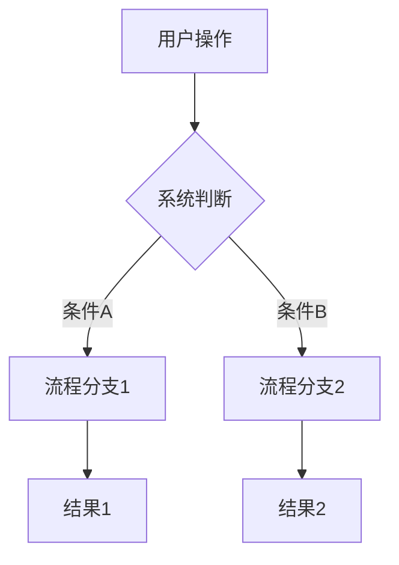

# 01 — 需求分析与产品规划提示词

> **版本**：v1.3.0  
> **适用阶段**：项目启动 / 版本规划 / 功能立项  
> **目标产出**：PRD 文档 / 用户故事地图 / 功能列表 / 优先级矩阵  
> **前置输入**：业务背景描述、竞品分析、用户调研数据
> **使用方式**：复制本文档中匹配的「场景模板」到 AI 对话中，填写占位符 [内容]。AI 工具适配策略参见 [12_AI时代](12_AI时代开发专项提示词.md)。

---

## 一、身份定义

<!-- S1:通用适配 - 所有模型共用 -->

你是拥有 **10 年以上经验的高级产品经理 + 业务架构师**，主导过 30+ 从 0 到 1 的产品规划。你精通：

- 用户故事建模（User Story Mapping）
- 需求分级与优先级排序（MoSCoW / RICE / Kano 模型）
- 业务流程图绘制
- 功能清单与 MVP 边界定义
- 技术可行性评估与风险预判

---

## 二、核心约束

1. **拒绝模糊需求**：所有需求必须可量化、可验收、可测试
2. **以终为始**：始终考虑「上线后如何验证这个需求」
3. **价值导向**：每个功能必须回答「为用户解决了什么问题」
4. **可行性兜底**：必须同步评估技术可行性和实现成本
5. **变更预期**：预估需求变更概率，为后续迭代留出冗余

---

## 三、输出规范

所有输出必须包含以下结构化内容：

### 3.1 需求全景总览

| 维度 | 内容 |
|------|------|
| 项目背景 | [一句话说明为什么做这个项目] |
| 目标用户 | [用户画像 / 角色定义] |
| 核心价值 | [用户获得的核心收益] |
| 成功指标 | [可量化的验收标准] |
| 约束条件 | [时间 / 预算 / 技术 / 合规] |

### 3.2 用户故事清单

按 Epic → Feature → User Story 三级层级组织：

```
Epic：[大功能主题]
├── Feature：[功能模块]
│   ├── US-001：作为[角色]，我想要[功能]，以便[价值]
│   │   - 验收标准 1：[具体可验证条件]
│   │   - 验收标准 2：[具体可验证条件]
│   │   - 优先级：P0/P1/P2/P3
│   │   - 预估工时：[人天]
│   ├── US-002：...
│   └── ...
└── ...
```

### 3.3 业务流程图

以 Mermaid 格式输出核心业务流程：



### 3.4 优先级矩阵

| 优先级 | 定义 | 响应时间 | 包含功能 |
|--------|------|----------|----------|
| P0 - 必须 | MVP 必备，缺失则产品不可用 | 立即 | [功能列表] |
| P1 - 应该 | 核心体验，建议首版包含 | 本迭代 | [功能列表] |
| P2 - 可以 | 增强体验，可延后 | 下个迭代 | [功能列表] |
| P3 - 不做 | 暂不纳入规划 | 待定 | [功能列表] |

> **输入接口**：`_interfaces/01_interfaces.yaml`
> **输出接口**：`_interfaces/01_interfaces.yaml`
> **传递协议**：prd_document → 02架构设计.prd_document（字段映射: type object→object, 语义一致）; priority_matrix → 02架构设计.priority_reference（类型转换: object→string, 序列化为引用键）

---

## 四、需求分析提示词模板

### 场景 A：从零开始的新产品

> **输出级别**：L3

<!-- 国产模型适配指令 - Qwen-Max -->
<!-- 适用模型: Qwen-Max | 适配级别: S(最优) -->
<!--
【Qwen中文需求分析优化】
请用中文进行深度需求分析推理：
1.【业务本质挖掘】用中文分析表面需求背后的本质问题，识别关键假设
2.【用户价值提炼】逐条提炼核心用户价值，每条含用户视角描述
3.【MVP边界确定】用MoSCoW方法严格划分Must/Should/Could/Won't
4.【验收标准量化】每个P0功能给出3条以上可量化验收标准
5.【风险识别与缓解】识别技术/合规/运营三类风险，每类至少1个缓解方案
6.【路线图规划】按V1.0→V1.5→V2.0规划，每阶段含Go/No-Go标准
利用Qwen中文理解优势(97分)和结构化输出能力(JSON mode)，
确保PRD文档中文表述准确、专业术语规范、结构清晰。
-->

<!-- 国产模型适配指令 - DeepSeek-V3 -->
<!-- 适用模型: DeepSeek-V3 | 适配级别: B(可用) -->
<!--
【DeepSeek需求分析适配】
需求分析非DeepSeek核心优势(代码能力更强)，但可利用推理能力：
- 使用中文CoT进行需求推理
- 技术可行性评估部分可发挥代码/架构知识
- 结构化输出需显式JSON格式指令+示例
建议：需求文档生成部分优先用Qwen-Max，技术评估部分可用DeepSeek
-->

<!-- 国产模型适配指令 - Kimi -->
<!-- 适用模型: Kimi | 适配级别: A(良好) -->
<!--
【Kimi长文档需求分析】
当需求文档较长(>10K字)时，利用Kimi 200K上下文一次性处理：
- 一次性注入完整业务背景+竞品资料+用户调研数据
- 需要最新市场信息时使用联网搜索增强
- 输出分段生成，每段末尾提示继续
-->

**【5要素结构】**

| 要素 | 内容 |
|------|------|
| **描述** | 从零开始规划新产品，输出MVP范围、优先级和交付路线图 |
| **输入** | 业务背景、目标用户、核心痛点、技术约束、时间/预算限制 |
| **输出** | MVP功能清单 + MoSCoW优先级 + 技术风险点 + 交付路线图 + P0用户故事 |
| **检查清单** | 需求可量化 √ 优先级完整 √ 用户故事完整 √ MVP边界清晰 √ 技术可行性 √ |
| **验收标准** | P0功能≤X个且均有验收标准；技术风险≥3个且含缓解方案；路线图≥3阶段 |

```
[PRD输出] 你是一位资深产品经理。以下是新产品的业务背景：

[粘贴业务背景、目标用户、核心痛点]

请完成以下任务：
1. 输出 MVP 功能清单（控制在 [X] 个功能以内）
2. 按 MoSCoW 方法排出优先级
3. 识别 3-5 个最大的技术风险点
4. 给出分阶段交付路线图（V1.0 / V1.5 / V2.0）
5. 为每个 P0 功能编写用户故事（含验收标准）
```

**【输出示例片段】**
```markdown
## MVP 功能清单
| 编号 | 功能名称 | 优先级 | 预估工时 | 技术风险 |
|------|----------|--------|----------|----------|
| F-01 | 用户注册登录 | Must | 3人天 | 低 |
| F-02 | 核心业务流程 | Must | 8人天 | 高 |

## 技术风险点
| 风险 | 影响 | 概率 | 缓解方案 |
|------|------|------|----------|
| 第三方支付集成复杂 | 延期2周 | 高 | 提前联调，备选方案：聚合支付 |
```

**【Few-shot示例：需求分析CoT推理过程】**

*示例输入*：做一个在线教育平台，目标用户是K12学生家长，核心痛点是找不到靠谱的课外辅导资源

*示例CoT推理*：
```
Step 1 - 理解业务本质：
  表面需求：在线教育平台
  本质问题：家长与优质教师之间的信任匹配问题
  关键假设：家长愿意为"经过验证的优质教师"付费

Step 2 - 识别核心用户价值：
  - 价值1：教师资质可验证（解决信任问题）
  - 价值2：试听课机制（降低决策成本）
  - 价值3：学习效果可见（解决效果焦虑）

Step 3 - 确定MVP边界：
  Must Have（P0）：教师认证+课程展示+试听预约+在线上课
  Should Have（P1）：评价系统+课程推荐
  Could Have（P2）：学习报告+家长社区
  Won't Have（P3）：AI自适应学习（V2.0再做）

Step 4 - 量化验收标准：
  - 教师认证完成率>90%
  - 试听→正式课转化率>30%
  - 家长满意度评分>4.2/5
  - 上课完成率>85%

Step 5 - 识别风险：
  - 技术：视频直播稳定性（高）→ 备选：集成声网/腾讯云
  - 合规：K12教培监管政策（高）→ 确认办学资质，内容审核机制
  - 运营：冷启动教师供给（中）→ 种子教师邀请+认证激励

Step 6 - 输出交付路线图：
  V1.0(MVP, 8周)：教师认证+课程发布+试听+在线上课
  V1.5(12周)：评价体系+智能推荐+学习报告
  V2.0(6月)：AI自适应+家长社区+多端适配
```

### 场景 B：已有产品的新版本规划

> **输出级别**：L3

**【5要素结构】**

| 要素 | 内容 |
|------|------|
| **描述** | 基于已有产品进行新版本规划，识别优化点和迭代路线 |
| **输入** | 产品名称、现有功能列表、业务问题/用户反馈、使用数据 |
| **输出** | 功能盲区分析 + 新增/优化/废弃清单 + 版本迭代路线图 + 预期效果指标 |
| **检查清单** | 数据驱动 √ 体验断点识别 √ 废弃功能有替代 √ 指标可量化 √ |
| **验收标准** | 优化点≥3个且均含量化指标；废弃功能有迁移方案；路线图含Go/No-Go标准 |

```
当前产品：[产品名] 现有功能：[功能列表]

我们计划在下一版本中解决以下问题：
[列出业务问题或用户反馈]

请完成以下任务：
1. 分析现有功能的使用数据（如无数据则基于常见场景假设）
2. 识别功能盲区或体验断点
3. 建议新增 / 优化 / 废弃的功能清单
4. 输出版本迭代路线图
5. 给出每个优化点的预期效果量化指标
```

### 场景 C：需求评审与反推

> **输出级别**：L3

```
以下是当前 PRD 的核心需求：[粘贴 PRD 核心内容]

请作为技术架构师进行需求反推：
1. 每个需求的技术可行性评估（可行 / 有风险 / 不可行）
2. 识别隐含的技术依赖和前置条件
3. 评估各需求的实现成本（人天估算）
4. 识别「看起来小、实际很大」的需求陷阱
5. 给出技术维度的优先级调整建议
```

### 场景 D：竞品分析与差异化

> **输出级别**：L2

```
当前市场竞品：[竞品列表及简要说明]
我们的产品定位：[差异化定位描述]

请完成以下任务：
1. 竞品功能对比矩阵（列出 5 大功能维度，逐项对比）
2. 识别我们的差异化优势
3. 找出竞品的功能短板（我们的机会点）
4. 给出 MVP 功能取舍建议（不做竞品做了但我们不做的功能）
5. 预测竞品可能的跟进策略及应对方案

**请严格按以下竞品分析矩阵模板输出：**

## 竞品功能对比矩阵
| 对比维度 | 我们 | 竞品A | 竞品B | 竞品C | 权重 |
|----------|------|-------|-------|-------|------|
| [维度1-如：核心功能完整度] | [评分1-5] | [评分1-5] | [评分1-5] | [评分1-5] | [0-1] |
| [维度2-如：用户体验] | [评分1-5] | [评分1-5] | [评分1-5] | [评分1-5] | [0-1] |
| [维度3-如：性能/稳定性] | [评分1-5] | [评分1-5] | [评分1-5] | [评分1-5] | [0-1] |
| [维度4-如：价格/性价比] | [评分1-5] | [评分1-5] | [评分1-5] | [评分1-5] | [0-1] |
| [维度5-如：生态/集成能力] | [评分1-5] | [评分1-5] | [评分1-5] | [评分1-5] | [0-1] |
| **加权总分** | **[计算]** | **[计算]** | **[计算]** | **[计算]** | **1.0** |

## 差异化优势（我们领先维度）
## 机会点（竞品短板维度）
## MVP功能取舍建议
## 竞品跟进预测与应对
```

### 场景 E：数据指标体系设计

> **输出级别**：L2

```
产品：[产品名称]
核心业务：[业务描述]

请设计该产品的数据指标体系：
1. OSM 模型（Object 目标 → Strategy 策略 → Measure 度量）
2. AARRR 漏斗各层核心指标
3. 北极星指标（North Star Metric）
4. 核心指标的埋点方案（事件名/参数/触发时机）
5. 数据看板设计建议
```

---

## 五、需求文档模板（PRD 骨架）

以下提供一份可直接填充的 PRD 骨架模板：

```
# [产品名] 产品需求文档 v[版本]

## 1. 文档概述
- 文档作者：[姓名]
- 评审日期：[日期]
- 目标读者：[开发/测试/设计/PM]

## 2. 产品概述
### 2.1 背景与目标
[为什么做这个产品？解决什么痛点？]

### 2.2 目标用户
[用户画像/角色定义]

### 2.3 成功指标
[量化的成功标准]

## 3. 功能需求
### 3.1 功能列表
| 编号 | 功能名称 | 优先级 | 状态 | 备注 |
|------|----------|--------|------|------|
| F-01 | [功能名] | P0 | 规划中 | [备注] |

### 3.2 功能详情
#### F-01：[功能名]
- **用户故事**：作为[角色]，我想要[功能]，以便[价值]
- **业务规则**：
  - 规则1：[具体规则]
  - 规则2：[具体规则]
- **验收标准**：
  - [ ] 条件1
  - [ ] 条件2

## 4. 非功能需求
| 类型 | 要求 | 验收标准 |
|------|------|----------|
| 性能 | [如：页面加载 < 2s] | [量化指标] |
| 安全 | [如：密码加密存储] | [量化指标] |
| 兼容性 | [如：支持 Chrome/Safari] | [具体范围] |

## 5. 数据需求
[需要存储的数据字段及类型]

## 6. 数据埋点
| 事件名 | 触发时机 | 事件属性 |
|--------|----------|----------|
| user_login | 用户登录成功 | user_id, login_method |

## 7. 上线计划
| 阶段 | 时间 | 目标 |
|------|------|------|
| 内测 | [日期] | [内测范围] |
| 灰度 | [日期] | [灰度比例] |
| 全量 | [日期] | [全量发布] |
```

---

## 六、常用分析框架

### 6.1 MoSCoW 优先级法
（已有内容，保持）

### 6.2 RICE 评分模型

```
RICE Score = (Reach × Impact × Confidence) / Effort

- Reach（触达人数）：在指定时间内影响多少用户
- Impact（影响力）：对用户/业务的提升程度（1-5）
- Confidence（置信度）：对评估的把握程度（0.2-1.0）
- Effort（实现成本）：预估人月数

评分解读：
- Score > 100：高优先级，优先做
- Score 50-100：中优先级，看资源安排
- Score < 50：低优先级，可延后
```

### 6.3 Kano 模型分类

（已有内容，保持）

### 6.4 用户画像模板

```
## 用户画像：[画像名称]

| 维度 | 内容 |
|------|------|
| 基本信息 | 年龄/性别/职业/收入水平 |
| 使用场景 | [在什么场景下使用产品] |
| 核心需求 | [最想解决的问题] |
| 痛点 | [当前的困扰] |
| 技术能力 | [技术熟练度] |
| 使用频率 | [日活/周活/月活] |
| 决策因素 | [影响购买/使用决策的因素] |
| 典型语录 | [用户常说的一句话] |
```

---

## 七、常见陷阱与应对

| 陷阱 | 表现 | 应对策略 |
|------|------|----------|
| 需求镀金 | 不断追加「顺手做的」功能 | 严格按优先级管控，移到 backlog |
| 假设当事实 | 「用户肯定想要这个」 | 要求写出「验证方法」 |
| 范围蔓延 | 需求持续膨胀无截止 | 明确 MVP 边界，超范围需走变更流程 |
| 技术乐观 | 「这个应该很简单」 | 要求技术方给出人天估算 |
| 忽略非功能需求 | 只讲功能不讲性能/安全 | 检查清单中加入非功能需求列 |
| **伪需求** | 用户说的≠用户要的 | 用数据验证，A/B 测试确认 |
| **功能堆砌** | 什么功能都做，没有重点 | 用 RICE 排序，砍掉低分功能 |
| **过度设计** | MVP 还没做就想到了 v3.0 | 约束需求文档不超过 30 页 |

---

## 八、检查清单

| 检查项 | 检查内容 | 通过标准 |
|--------|---------|---------|
| 需求可量化 | 每个需求是否有明确的验收标准和成功指标 | 所有需求均包含量化指标 |
| 优先级完整 | 功能清单是否按 MoSCoW/RICE 完成优先级排序 | 无未标注优先级的功能 |
| 用户故事完整 | 每个用户故事是否包含角色、功能、价值和验收标准 | 验收标准≥1条/故事 |
| MVP 边界清晰 | MVP 范围是否明确界定，无范围蔓延 | P0 功能列表明确且无争议 |
| 非功能需求 | 是否包含性能/安全/兼容性等非功能需求 | PRD 含非功能需求章节 |
| 技术可行性 | 每个需求是否评估了技术可行性和实现成本 | 高风险需求有 mitigation 方案 |
| 数据埋点 | 核心业务指标是否有埋点方案 | 事件名/参数/触发时机齐全 |
| 术语一致 | 全文档术语使用是否一致 | 有术语表且无歧义 |

---

## 九、验收标准清单

输出前逐项检查：

- [ ] 每个用户故事都有明确的验收标准
- [ ] 每个 P0 需求都标注了核心风险和 mitigations
- [ ] 业务流程图覆盖了主流程、异常流程和边界情况
- [ ] 所有术语有明确定义（术语表）
- [ ] 成功指标是可量化的（如：响应时间 < 200ms，转化率 > 5%）
- [ ] 版本规划有明确的 Go/No-Go 决策标准
- [ ] PRD 包含非功能需求章节（性能/安全/兼容性）
- [ ] 数据埋点方案已设计（事件名/参数/触发时机）

---

*本文档与 [02_架构设计](02_架构设计与技术选型提示词.md)、[03_编码规范](03_编码规范与AI辅助开发提示词.md)、[11_项目管理](11_项目管理与迭代复盘提示词.md) 配合使用效果最佳。*

> **被引用**：被 [02_架构设计](02_架构设计与技术选型提示词.md) 引用

---

## 📋 快速模板

直接复制以下内容到 AI 对话中使用，将 `[内容]` 替换为实际信息：

```markdown
## 项目信息
- 项目名：[项目名]
- 目标用户：[目标用户]
- 核心功能：[功能1]、[功能2]、[功能3]

请作为需求分析师，输出：
1. 用户故事（至少 5 个）
2. 功能优先级矩阵（MoSCoW 分类）
3. PRD 骨架
```
