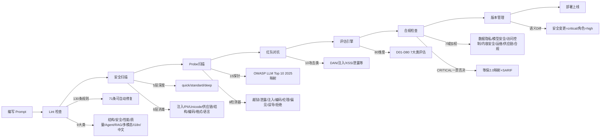
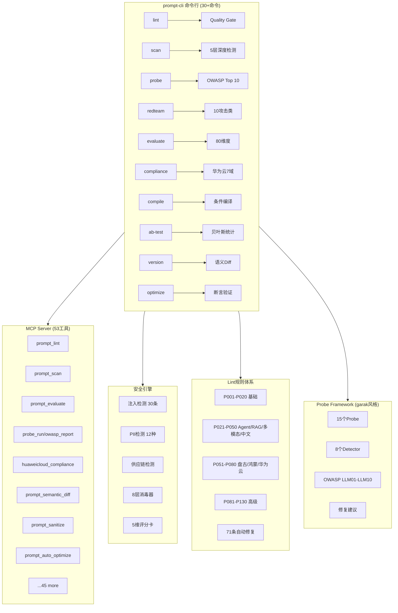

# AI Prompt Toolkit

> AI提示词工业级工具链 — Lint / 安全扫描 / 红队对抗 / 评估 / 合规 / MCP Server

[](https://python.org)
[](LICENSE)
[](CHANGELOG.md)
[](tests/)
[](src/ai_prompt_toolkit/linter/)
[](src/ai_prompt_toolkit/evaluator.py)
[](src/ai_prompt_toolkit/mcp_server.py)
[](src/ai_prompt_toolkit/probe_framework.py)

## 项目简介

**ai-prompt-toolkit** 是一个面向AI提示词工程的全生命周期工具链，提供从编写、质量检查、安全扫描、红队对抗、合规评估到版本管理的完整解决方案。类似ESLint之于JavaScript，prompt-cli之于Prompt工程。

### 核心数据

| 能力 | 数量 | 详情 |
|------|------|------|
| **Lint规则** | 140 | P001-P140，71条可自动修复，含10条多模态专项规则(P131-P140) |
| **评估维度** | 80 | D01-D80，6大类(structure/quality/security/performance/fairness/toolchain) |
| **安全注入检测** | 30 | 15条英文+15条中文注入规则 |
| **PII隐私检测** | 12 | 姓名/身份证/手机/邮箱/银行卡/地址等 |
| **红队探针** | 23 | DAN/编码绕过/注入/泄露/XSS/包幻觉/坏字符/GCG/滚雪球/恶意软件/系统提示泄露/向量嵌入/Grandma/续写/DonotAnswer/Agent注入/工具滥用/权限提升/目标劫持/多Agent对抗/图像注入/音频注入/跨模态泄露 |
| **红队检测器** | 11 | 越狱关键词/系统提示泄露/注入模式/编码异常/伦理对齐/偏见公平/误导/拒绝/Agent行为异常/多模态输出检测/链式攻击检测 |
| **MCP工具** | 53 | 完整MCP Server，字典O(1)路由 |
| **LLM Provider** | 24 | OpenAI/Claude/DeepSeek/通义千问/智谱/Moonshot/百度/MiniMax/华为/盘古/ModelArts/豆包/星火/百川/商汤等 |
| **内置模板** | 18 | 华为云/鸿蒙/盘古5/通用QA等 |
| **Prompt消毒** | 8层 | 注入/PII/Unicode/供应链/结构/编码/格式/语言 |

### 核心特性

| 功能 | CLI命令 | 描述 |
|------|---------|------|
| **Prompt Linter** | `prompt-cli lint` | 130条Lint规则(P001-P130)，71条可自动修复，涵盖结构/安全/性能/质量/Agent/RAG/多模态/i18n/中文9大类 |
| **安全扫描** | `prompt-cli scan` | 5层深度检测(quick/standard/deep)，注入检测+PII+供应链+结构+消毒器 |
| **Quality Gate** | `prompt-cli lint --gate` | CI模式Verdict门禁(PASS/WARN/FAIL)，退出码0/1/2，SARIF输出 |
| **红队对抗** | `prompt-cli redteam` | 15个Probe+8个Detector，OWASP LLM Top 10 2025映射，自动风险评分 |
| **Probe扫描** | `prompt-cli probe` | garak风格Probe Framework，15探针8检测器，OWASP合规报告 |
| **评估引擎** | `prompt-cli evaluate` | 80个评估维度(D01-D80)，快速/完整双模式，7大类评估 |
| **华为云合规** | `prompt-cli compliance` | 7域加权评分(数据隐私/模型安全/访问控制/内容安全/运维安全/供应链安全/合规认证)，等保2.0映射，CRITICAL一票否决 |
| **条件编译** | `prompt-cli compile` | 按模型/语言/行业条件编译提示词模板（类C预处理器语法） |
| **A/B测试** | `prompt-cli ab-test` | 贝叶斯统计(Thompson Sampling+SPRT)，21种LLM Provider |
| **版本管理** | `prompt-cli version` | Git-like diff/rollback，语义Diff(安全策略变更=critical) |
| **Prompt优化** | `prompt-cli optimize` | 自动优化+7种断言验证(contains/not_contains/regex/length_min/max/no_pii/no_injection) |
| **MCP Server** | `prompt-cli serve` | 53个MCP工具，标准JSON-RPC协议，字典O(1)路由 |
| **评分卡** | `prompt-cli scorecard` | 5维度评分(安全/合规/质量/性能/可用性)，SVG徽章生成 |
| **安全评分** | `prompt-cli score` | CVSS-like安全评分+SVG Badge |
| **Badge生成** | `prompt-cli badge` | 评分→SVG徽章，一键嵌入README |
| **Token分析** | `prompt-cli token` | 多模型Token统计(GPT-4/Claude/盘古等) |
| **Canary水印** | `prompt-cli canary` | 注入/检测Canary Token，泄露追踪 |
| **模板市场** | `prompt-cli market` | REST API(FastAPI)，发布/评审/灰度部署 |
| **Watch模式** | `prompt-cli watch` | 文件变更自动Lint+合规检查 |
| **健康检查** | `prompt-cli doctor` | 环境依赖+配置完整性检查 |
| **国际化** | `prompt-cli i18n` | LLM翻译+术语表+回退策略 |
| **评估对比** | `prompt-cli eval-compare` | 多版本评估结果对比 |
| **交互向导** | `prompt-cli wizard` | 引导式Prompt创建 |

### 差异化优势

- **全生命周期覆盖**：唯一覆盖 Lint→Scan→Probe→RedTeam→Evaluate→Compliance→Version 全链路的Prompt工具
- **零LLM调用Lint**：130条静态分析规则(71条可自动修复)，无需消耗Token即可检测Prompt质量
- **OWASP LLM Top 10 2025**：15个Probe→LLM01-LLM10完整映射，自动生成合规报告+修复建议
- **华为云合规引擎**：7域加权评分+等保2.0映射+CRITICAL一票否决+SARIF输出
- **语义Diff**：安全策略变更=critical级告警，角色/约束变更=high级
- **Prompt消毒器**：8层检测管线(注入/PII/Unicode/供应链/结构/编码/格式/语言)
- **21种LLM Provider**：支持OpenAI/Claude/DeepSeek/通义千问/智谱/华为盘古等国内外模型
- **中文优先**：15条中文注入检测规则、中文标点/Token/冗余特有Lint、人话翻译报错
- **MCP Server**：53个标准MCP工具，支持Claude Desktop等MCP客户端直接调用

## 快速开始

### 安装

```bash
# 基础安装
pip install ai-prompt-toolkit

# 完整安装（含A/B测试+模板市场）
pip install "ai-prompt-toolkit[full]"

# 仅A/B测试
pip install "ai-prompt-toolkit[ab_test]"
```

### 基本使用

```bash
# Lint检查(130条规则)
prompt-cli lint -s my_prompt.md

# 安全扫描(5层深度)
prompt-cli scan -s my_prompt.md --depth deep

# 红队对抗(15 Probe + 8 Detector)
prompt-cli redteam -s my_prompt.md --probe dan,jailbreak

# Probe扫描(OWASP LLM Top 10 2025)
prompt-cli probe -s my_prompt.md --probe all

# 评估(80维度)
prompt-cli evaluate -s my_prompt.md --mode full

# 华为云合规检查
prompt-cli compliance -t my_prompt.md --format cli

# 条件编译
prompt-cli compile -s template.md -c context.json

# A/B测试
prompt-cli ab-test -c ab_config.yaml

# 版本管理
prompt-cli version diff my_prompt.md
prompt-cli version rollback my_prompt.md --rev 3

# 语义Diff(安全策略变更=critical)
prompt-cli diff old_prompt.md new_prompt.md --semantic

# Prompt优化+断言验证
prompt-cli optimize -s my_prompt.md
prompt-cli assert -s my_prompt.md --assertion "contains:安全声明"

# MCP Server(53个工具)
prompt-cli serve

# Watch模式(变更自动Lint+合规)
prompt-cli watch -s ./prompts/ --compliance

# 安全评分+Badge
prompt-cli score -t my_prompt.md
prompt-cli badge -t my_prompt.md

# Canary水印
prompt-cli canary inject -s my_prompt.md
prompt-cli canary check -s leaked_prompt.md

# Token分析(多模型)
prompt-cli token -s my_prompt.md

# 健康检查
prompt-cli doctor

# 交互式向导
prompt-cli wizard
```

### Docker

```bash
docker build -t prompt-cli .
docker run --rm prompt-cli lint -s /app/my_prompt.md
```

## 项目架构

```
src/ai_prompt_toolkit/
├── cli.py                    # CLI兼容层
├── cli_core.py               # CLI实现(30+命令)
├── mcp_server.py             # MCP Server(53工具,字典O(1)路由)
├── linter/                   # Prompt Linter引擎
│   ├── linter.py             # Lint核心引擎
│   ├── rules.py              # 规则注册中心(_RULE_MAP)
│   ├── rules_p001_p020.py    # P001-P020 基础规则
│   ├── rules_p021_p030.py    # P021-P030 Agent/RAG/多模态
│   ├── rules_p031_p040.py    # P031-P040
│   ├── rules_p041_p050.py    # P041-P050 lintlang+中文
│   ├── rules_p051_p055.py    # P051-P055
│   ├── rules_p056_p062.py    # P056-P062
│   ├── rules_p063_p070.py    # P063-P070 盘古/鸿蒙/华为云
│   ├── rules_p071_p080.py    # P071-P080 高级
│   ├── rules_p081_p100.py    # P081-P100
│   ├── rules_p101_p120.py    # P101-P120
│   ├── rules_p121_p130.py    # P121-P130
│   ├── quality_gate.py       # Verdict Quality Gate
│   ├── friendly_descriptions.py  # 人话翻译
│   ├── fixer.py              # 自动修复(71条AUTO_FIXABLE)
│   └── lsp_server.py         # LSP协议服务
├── security/                 # 安全扫描引擎
│   ├── scanner.py            # 扫描编排器(5层)
│   ├── injection_detector.py # 注入检测(15条)
│   ├── zh_injection_rules.py # 中文注入(15条)
│   ├── pii_detector.py       # PII隐私检测(12种)
│   ├── supply_chain_detector.py  # 供应链检测(含AI工具链)
│   ├── huaweicloud_compliance.py # 华为云7域合规
│   ├── prompt_scorecard.py   # 5维度评分卡
│   ├── prompt_sanitizer.py   # 8层Prompt消毒器
│   ├── structural_analyzer.py    # 结构/边界/操控/熵分析
│   ├── scorer.py             # CVSS-like安全评分
│   └── inheritance_auditor.py    # 继承审计
├── probe_framework.py        # garak风格Probe Framework(15探针+8检测器)
├── evaluator.py              # 评估引擎(80维度,7大类)
├── prompt_optimizer.py       # Prompt优化+verify_assertions(7种)
├── prompt_diff.py            # 语义Diff+合并+哈希
├── prompt_template.py        # 18个内置模板(华为云/鸿蒙/盘古5)
├── prompt_cache.py           # LRU/TTL缓存+华为云LTS
├── prompt_version.py         # Git-like版本管理
├── version_store.py          # 版本存储
├── attack_vault.py           # 向量相似度攻击签名
├── adversarial.py            # 10个攻击类
├── compiler/                 # 条件编译引擎
├── redteam/                  # 红队对抗引擎
├── ab_test/                  # A/B测试引擎(21 Provider)
├── i18n/                     # 国际化引擎
├── market/                   # 模板市场(FastAPI)
├── dataset/                  # 数据集管理
├── flow/                     # Flow DAG引擎
├── tracing/                  # 分布式追踪
├── templates/                # 模板目录包
└── onboarding/               # 交互式向导
```

### 全生命周期流程图



### 系统架构图



## 评估维度 (80个)

| 类别 | 维度 | 示例 |
|------|------|------|
| **structure** | 11 | D01角色清晰度/D02指令明确性/D03约束完整性/D04输出格式/... |
| **quality** | 17 | D17示例覆盖/D18错误处理/D19边界情况/D25思维链/D26工具调用/... |
| **security** | 12 | D34注入防御/D35PII保护/D36供应链安全/D74隐私合规/D75审计追溯/... |
| **performance** | 10 | D46Token效率/D47缓存友好/D48延迟优化/... |
| **fairness** | 5 | D54偏见检测/D55公平性/D72伦理对齐/D73偏见缓解/... |
| **toolchain** | 25 | D56模板化/D57版本管理/D66CoT/D78i18n/D79盘古适配/D80鸿蒙贴合/... |

## 内置模板 (18个)

| 模板 | 用途 |
|------|------|
| general-qa | 通用问答 |
| code-review | 代码审查 |
| harmonyos-component | 鸿蒙ArkTS组件 |
| huaweicloud-deploy | 华为云部署 |
| pangu-chat | 盘古对话 |
| pangu-function-call | 盘古函数调用 |
| harmonyos-ability | 鸿蒙Ability开发 |
| huaweicloud-maas-finetune | 华为云MaaS微调 |
| huaweicloud-sec-audit | 华为云安全审计 |
| pangu5-multimodal | 盘古5多模态 |
| pangu5-agent | 盘古5 Agent |
| harmonyos5-ai-app | 鸿蒙5 AI应用 |
| pangu5-vision | 盘古5视觉 |
| pangu5-code | 盘古5代码 |
| harmonyos5-widget | 鸿蒙5卡片 |
| harmonyos5-ai-agent | 鸿蒙5 AI Agent |
| huaweicloud-secops | 华为云安全运维 |
| pangu5-reasoning | 盘古5推理 |

## 华为云合规引擎

7域加权评分体系：

| 域 | 权重 | 检查项 |
|----|------|--------|
| 数据隐私 | 20% | PII检测/数据分类/跨境合规 |
| 模型安全 | 20% | 注入防御/输出过滤/模型鲁棒性 |
| 访问控制 | 15% | 权限管理/认证授权/审计 |
| 内容安全 | 15% | 有害内容/偏见公平/伦理对齐 |
| 运维安全 | 10% | 日志监控/应急响应/变更管理 |
| 供应链安全 | 10% | 依赖审计/包幻觉检测/资源注入 |
| 合规认证 | 10% | 等保2.0/GDPR/PIPL映射 |

合规等级：A(90+) / B(75+) / C(60+) / D(40+) / F(<40)
决策：PASS / CONDITIONAL / FAIL (CRITICAL一票否决)

```bash
# CLI输出
prompt-cli compliance -t my_prompt.md --format cli

# SARIF输出(GitHub Code Scanning)
prompt-cli compliance -t my_prompt.md --format sarif

# Markdown报告
prompt-cli compliance -t my_prompt.md --format markdown
```

## Probe Framework (OWASP LLM Top 10 2025)

| OWASP ID | 风险 | Probe |
|----------|------|-------|
| LLM01 | Prompt注入 | PromptInjectProbe |
| LLM02 | 不安全输出处理 | XSSInjectProbe |
| LLM03 | 训练数据投毒 | PackageHallucinationProbe |
| LLM04 | 模型拒绝服务 | BadCharsProbe |
| LLM05 | 供应链漏洞 | SupplyChainDetector |
| LLM06 | 敏感信息泄露 | SystemPromptLeakProbe, LeakReplayProbe |
| LLM07 | 不安全插件设计 | EncodingBypassProbe |
| LLM08 | 过多代理权限 | DANProbe, GrandmaProbe |
| LLM09 | 过度依赖 | SnowballProbe, ContinuationProbe, DonotAnswerProbe |
| LLM10 | 模型盗窃 | VectorEmbeddingProbe |

## VSCode插件

项目包含VSCode扩展 `vscode-prompt-lint/` v0.4.0，提供：

- 实时Lint诊断(130条规则) + 防抖300ms
- Prompt语法高亮({{变量}}//角色标签/系统指令)
- 状态栏评分指示器
- 保存时自动检查 + 打开文件自动Lint
- 安全扫描集成(30条含中文注入)
- PII隐私检测
- Quality Gate检查
- Front Matter验证
- 严重级别覆盖配置
- 快速修复Code Actions
- CodeLens评分+Quality Gate入口

详见 [vscode-prompt-lint/README.md](vscode-prompt-lint/README.md)

## CI/CD集成

```yaml
# GitHub Actions示例 - Quality Gate
- name: Prompt Lint with Quality Gate
  run: prompt-cli lint -t ./prompts/ --gate

# SARIF输出 - GitHub Code Scanning
- name: Prompt Lint (SARIF)
  run: prompt-cli lint -t ./prompts/ --format sarif --output results.sarif

# 安全扫描(5层深度)
- name: Prompt Security Scan
  run: prompt-cli scan -t ./prompts/ --depth deep

# 华为云合规检查
- name: Huawei Cloud Compliance
  run: prompt-cli compliance -t ./prompts/ --format sarif

# OWASP LLM Top 10 扫描
- name: OWASP LLM Scan
  run: prompt-cli probe -t ./prompts/ --probe all
```

项目内置GitHub Actions Workflow：
- `quality-gate.yml` - 质量门禁
- `owasp-llm-scan.yml` - OWASP深度扫描+Compliance Gate阻断
- `daily-scorecard.yml` - 每日安全评分卡
- `prompt-lint.yml` - Prompt Lint
- `prompt-quality-gate.yml` - Prompt质量门禁

## 开发

```bash
# 开发环境
pip install -e ".[dev]"

# 运行测试(2674个)
pytest tests/ -v

# 代码格式化
black src/ tests/
isort src/ tests/
```

## 许可证

MIT License

## 链接

- [变更日志](CHANGELOG.md)
- [术语表](_glossary.md)
- [适配矩阵](_adaptation_matrix.md)
