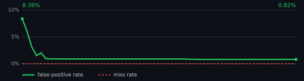

# AI Prompt Toolkit

> **确定性的 Prompt 静态门禁** — 零 LLM · 可复现 · <100ms · SARIF/CI 原生。
> 一次 CI fail 后重跑 pass 的门禁等于没有门禁。我们的门禁每次裁决逐字节一致。

[](https://python.org)
[](LICENSE)
[](CHANGELOG.md)
[](tests/)
[](docs/规则漏检率基线.md)
[](docs/规则误报率基线.md)
[](src/ai_prompt_toolkit/linter/)
[](src/ai_prompt_toolkit/evaluator.py)
[](src/ai_prompt_toolkit/mcp_server.py)
[](src/ai_prompt_toolkit/probe_framework.py)
[](.github/workflows/ci-green-streak.yml)

**为什么该信这个工具？** 双基线不写在嘴边上，写在一行命令里 —— 样本(667 条 golden
攻击探针 + 60 个干净 prompt)随包分发，任何机器 `pip install` 后一条命令自证：

```bash
pip install ai-prompt-toolkit
prompt-cli baseline
# 漏检面  0.00%  |  探针 667 条 · 期望命中单元 379
# 误报面  0.82%  |  干净样本 60 个 · checker 268 条
```

> **Quick start (no install):** `pipx run ai-prompt-toolkit lint <file>` — first finding in seconds.

**误报率收紧史**（每轮从 `docs/baseline_history.jsonl` 确定性重生成，逐字节一致；
固定刻度 0–10%，曲线不随数据缩放）：

[](docs/baseline_history.jsonl)

**过防御（over-defense）外部锚点**——内部 60 样本是自选面，真正的试金石是
"含触发词的良性语句会不会被误杀"（support ticket 引用攻击串/安全文档本身）。
用 PIGuard NotInject 339 条硬负样本（ACL 2025，独立 holdout，规则从未调优过）
实测：**安全族误杀率 11.50%**（89 规则 @ 339 样本，首点 33.92%，R250→R251→R253
逐批探针先行修复后 11.50%，见
[`docs/overdefense_history.jsonl`](docs/overdefense_history.jsonl) 时间序列）——
这个数字如实公开，治理清单（P2-26）按命中数降序逐条探针先行修复，
曲线只收紧不放松。

**第三方佐证（埋入式注入 TN 纪律）**：误报面最难的一条边界是
"安全文档引用攻击短语 = 良性，不是攻击"。2026 年学术 FP 审计
（rezaduty/prompt-detector-channel-audit，7 检测器规则通道审计）发现
"其注入规则标记的 9 条良性 8 条是安全文档引用攻击短语"（规则通道
匹配词汇而非意图）；Google Model Armor 日语实测（2026，zenn/Accenture）
同型：良性文本逐字引用攻击短语 5 例中 1 例误判。golden 探针集按此
边界构造（含埋入式引用形态 TN），误报面 0.82%（60 干净样本）是
`prompt-cli baseline` 一条命令在任何机器可复现的自证数字。

**10 行接入 CI**（完整 Day0/Day1 采用清单见 [docs/adoption.md](docs/adoption.md)）：

```yaml
# .github/workflows/prompt-ci.yml
- run: pip install ai-prompt-toolkit
- run: prompt-cli lint -t ./prompts --format sarif -o lint.sarif --gate
- uses: github/codeql-action/upload-sarif@v4
  with:
    sarif_file: lint.sarif
```

**缺口体检（OWASP LLM Top 10 防御声明面）**：`prompt-cli gap-report -t ./prompts`
对每个文件×每个风险度量**双口径**：存在性（是否声明了防御意图）+ 质量（命中多少防御面），
产出可复现的缺口占比。对本仓库 26 个内置模板的自体检：存在性缺口率 24.6%（R284 补强后，
原 86%）；平均声明质量 33%（质量缺口 67%——薄声明，R284 口径升级暴露的真实面）。残留缺口
（LLM09 向量 25 / LLM06 无约束消耗 17 / LLM04 供应链 12 / LLM03 越权 10）多为模板真实不
涉及的攻击面 —— 完整报告见 [docs/gap_report.md](docs/gap_report.md)。
口径诚实声明：双口径均为静态文本面，非防御实际有效性；存在性可被"凑一个词"刷低，
质量分要求覆盖面，更诚实（R235 关切，R284 落地）。

**老仓库接入（存量不清零也能开门禁）**：`prompt-cli lint -t ./prompts --baseline
base.json --baseline-save` 锁存量，CI 用 `--incremental --gate` 只拦 NEW findings，
存量 PRE-EXISTING 放行 —— 采用路径见 [docs/adoption.md](docs/adoption.md)。

---

<details>
<summary>📦 能力全貌（268 规则 / 130 维度 / 73 MCP / 23 探针，展开看）</summary>

## 项目简介

**ai-prompt-toolkit** 是一个面向AI提示词工程的全生命周期工具链，提供从编写、质量检查、安全扫描、红队对抗、合规评估到版本管理的完整解决方案。类似ESLint之于JavaScript，prompt-cli之于Prompt工程。

### 核心数据

| 能力 | 数量 | 详情 |
|------|------|------|
| **Lint规则** | 268 | P001-P268，196条可自动修复，含多模态/安全/供应链/Agent/可移植性等25大类专项规则 |
| **评估维度** | 130 | D01-D130，8大类(structure/quality/security/performance/fairness/toolchain/harmonyos/compliance) |
| **安全注入检测** | 30 | 15条英文+15条中文注入规则 |
| **PII隐私检测** | 12 | 姓名/身份证/手机/邮箱/银行卡/地址等 |
| **红队探针** | 23 | DAN/编码绕过/注入/泄露/XSS/包幻觉/坏字符/GCG/滚雪球/恶意软件/系统提示泄露/向量嵌入/Grandma/续写/DonotAnswer/Agent注入/工具滥用/权限提升/目标劫持/多Agent对抗/图像注入/音频注入/跨模态泄露 |
| **红队检测器** | 11 | 越狱关键词/系统提示泄露/注入模式/编码异常/伦理对齐/偏见公平/误导/拒绝/Agent行为异常/多模态输出检测/链式攻击检测 |
| **MCP工具** | 73 | 完整MCP Server，字典O(1)路由 |
| **LLM Provider** | 25 | OpenAI/Claude/DeepSeek/通义千问/智谱/Moonshot/百度/MiniMax/华为/盘古/ModelArts/豆包/星火/百川/商汤等 |
| **内置模板** | 18 | 华为云/鸿蒙/盘古5/通用QA等 |
| **Prompt消毒** | 8层 | 注入/PII/Unicode/供应链/结构/编码/格式/语言 |

### 核心特性

| 功能 | CLI命令 | 描述 |
|------|---------|------|
| **Prompt Linter** | `prompt-cli lint` | 268条Lint规则(P001-P268)，196条可自动修复，涵盖结构/安全/性能/质量/Agent/RAG/多模态/i18n/中文/可移植性等25大类 |
| **安全扫描** | `prompt-cli scan` | 5层深度检测(quick/standard/deep)，注入检测+PII+供应链+结构+消毒器 |
| **MCP配置扫描** | `prompt-cli mcp-lint` | 配置级8项安全检查 + tool描述security族规则(8类) + TPA/FSP注入形态检测(MCP-111/112, inputSchema递归walk, OWASP MCP03) + rug pull检测(description已批准基线, `--baseline/--baseline-out`) + Risk Score(0-100四档) |
| **Quality Gate** | `prompt-cli lint --gate` | CI模式Verdict门禁(PASS/WARN/FAIL)，退出码0/1/2，SARIF输出 |
| **红队对抗** | `prompt-cli redteam` | 23探针(15 Probe+8 Detector)+11内置检测器(全局注册表116)，OWASP LLM Top 10 2026映射，自动风险评分 |
| **Probe扫描** | `prompt-cli probe` | garak风格Probe Framework，23探针(15+8)+11内置检测器(全局注册表116)，OWASP合规报告 |
| **评估引擎** | `prompt-cli evaluate` | 130个评估维度(D01-D130)，快速/完整双模式，8大类评估 |
| **华为云合规** | `prompt-cli compliance` | 7域加权评分(数据隐私/模型安全/访问控制/内容安全/运维安全/供应链安全/合规认证)，等保2.0映射，CRITICAL一票否决 |
| **条件编译** | `prompt-cli compile` | 按模型/语言/行业条件编译提示词模板（类C预处理器语法） |
| **A/B测试** | `prompt-cli ab-test` | 贝叶斯统计(Thompson Sampling+SPRT)，25种LLM Provider |
| **版本管理** | `prompt-cli version` | Git-like diff/rollback，语义Diff(安全策略变更=critical) |
| **Prompt优化** | `prompt-cli optimize` | 自动优化+7种断言验证(contains/not_contains/regex/length_min/max/no_pii/no_injection) |
| **MCP Server** | `prompt-cli mcp` | 73个MCP工具，标准stdio JSON-RPC，字典O(1)路由 |
| **评分卡** | `prompt-cli score` | 5维度评分(安全/合规/质量/性能/可用性)，SVG徽章生成 |
| **安全评分** | `prompt-cli score` | CVSS-like安全评分+SVG Badge |
| **Badge生成** | `prompt-cli badge` | 评分→SVG徽章，一键嵌入README |
| **Token分析** | `prompt-cli token` | 多模型Token统计(GPT-4/Claude/盘古等) |
| **Canary水印** | `prompt-cli canary` | 注入/检测Canary Token，泄露追踪 |
| **模板市场** | `prompt-cli market` | REST API(FastAPI)，发布/评审/灰度部署 |
| **Watch模式** | `prompt-cli watch` | 文件变更自动Lint+合规检查 |
| **健康检查** | `prompt-cli doctor` | 环境依赖+配置完整性检查 |
| **国际化** | `prompt-cli i18n` | LLM翻译+术语表+回退策略 |
| **评估对比** | `prompt-cli eval-compare` | 多版本评估结果对比 |
| **交互向导** | `prompt-cli wizard` | 引导式Prompt创建 |
| **双基线自证** | `prompt-cli baseline` | 漏检/误报基线一条命令复现，样本随包分发，零LLM确定性度量 |
| **缺口体检** | `prompt-cli gap-report` | OWASP LLM Top 10 每文件×每风险防御声明缺口统计，JSON+MD，可复现缺口占比 |
| **增量门禁** | `prompt-cli lint --incremental` | 与--baseline+--gate组合：门禁只拦NEW findings，存量放行（brownfield接入） |
| **Waiver审计** | `prompt-cli audit-waivers` | 全仓豁免声明审计：无owner/过期/未注册规则告警，`--fail-on expired` 进CI门禁 |
| **门禁自检** | `prompt-cli doctor --gate` | 版本/规则数/基线/双基线/依赖/waiver面一站式自检，排查"为什么CI没跑" |

</details>

### 与 LLM 系竞品的结构性差异

promptfoo / garak / PromptGuard 等主流工具走 LLM 驱动路线。对**评估**场景它们是
好工具；对 **CI 门禁**场景，非确定性是结构性缺陷，不是参数调得出来的：

| 门禁要求 | LLM 系工具（promptfoo/garak 路线） | 本工具（确定性静态） |
|---|---|---|
| 重跑结果一致 | 有采样方差 — promptfoo 官方文档明说 eval 输出 non-deterministic，需用 `repeat:3` + `repeat-min-pass:2` **多次采样**对冲 | 逐字节一致，重跑 1000 次裁决相同 |
| 统计噪音 | garak 门禁实践：即便 pin 版本 + fixed seed，仍需 **one-sided Fisher 检验**对比基线；其作者实测 2 行 diff 的 no-op PR 误红率约 54% | 无采样 → 无 Fisher → 无统计误红；规则变更才变裁决，可审计 |
| API key / 供应商 | 需要 `PROMPTFOO_API_KEY` 或 LLM endpoint，CI 多一层密钥管理+供应商可用性依赖 | 零 key，离线可跑，air-gap 环境可用 |
| 门禁延迟 | LLM 调用数百毫秒~秒级/样本 | <100ms/文件，可进 pre-commit 钩子 |
| 成本模型 | 按 token 计费，PR 数量×样本数线性增长 | 0 调用，CI 成本与使用量无关 |

这不是贬低 LLM 路线 —— 语义层攻击（创意越狱/间接注入的对抗性改写）确实是纯静态
检测的机制上限，应组合使用运行时防护（LLM Guard 类）。**分工**：本工具做 CI 门禁
（可复现裁决层），LLM 系工具做语义评估与红队探测，两者互补不互替。

### 同类静态 Prompt 工具对比（2026-10 核实）

| 维度 | 本工具 | aiproof (Rust) | mcp-audit | mcpscan | prompt-guard/promptlint 系（cognis/LintLang 等） |
|------|--------|---------------|-----------|---------|---------------------------|
| 语言/依赖 | Python 零核心第三方依赖 | Rust 单二进制 | Python（Semgrep+Sigstore+CVE feed，依赖重） | Python | Python/Node，纯正则 |
| 检测面 | Prompt 全生命周期（lint/scan/probe/redteam/合规/版本）+ MCP 配置 | Prompt 静态 + 从代码抽取 inline prompt + 可移植性 | MCP 供应链全栈（SBOM/SAST/live server） | MCP 七模块（scan/harden/auth/pin） | Prompt 正则 lint（LintLang 另加 agent-config 面） |
| OWASP LLM Top 10 映射 | **2026 版（当前）+ ATLAS + 等保 2.0 三标准** | 无公开标准映射 | CVE/ATTACK 面 | 无 | 部分 |
| 裁决确定性 | 逐字节可复现 + 双基线时间序列（漏检/误报可一条命令复现） | 确定性静态 | 依赖运行时/网络 feed | 部分 | 确定性静态 |
| 增量门禁 | 双基线（FP 棘轮 + 存量锁定）+ 增量只拦 NEW | 无公开基线纪律 | 有 | 有 | 无 |
| 中文规则/报告 | 15 条中文注入检测 + 中文规则族 + 人话报错 + **分语言检测基线表** | 无 | 无 | 无 | 部分 |

> 定位澄清：本工具做 **CI 门禁层**（可复现裁决）；运行时防护（LLM Guard 类）、
> LLM 评估（promptfoo 类）互补不互替。MCP 检测面见下方"适用边界"。

### 与 promptfoo 双轨共存（PR 静态层 + eval 统计层）

组合模式：`prompt-cli lint --gate` 做 **PR 必跑**的确定性静态门禁（<100ms/文件，零 token），
promptfoo eval 做 **PR 后/nightly** 的行为评估（采样层，不阻塞合并——方差层做门禁会制造
统计误红）。检测面不重叠：静态层挡结构缺陷（硬编码凭据/声明矛盾/缓存不友好），eval 层挡
语义行为（越狱成功/质量漂移）。可直接套用的双轨 workflow + 本地开发循环 +
与 promptfoo code-scans 的区别表见 **[docs/promptfoo-coexistence.md](docs/promptfoo-coexistence.md)**。

### MCP 检测适用边界（诚实声明）

`mcp-lint` 是 **config/description 静态面**检测：能挡显式投毒（恶意指令/
`ignore previous` 类）、**TPA/FSP 工具定义注入**（MCP-111 顶层 description /
MCP-112 inputSchema 递归 walk——指令标签+敏感文件外传+键名指令形态，
OWASP MCP Top 10 MCP03，真实 payload 探针先行）、rug pull（description
批准基线漂移）、隐藏通道（零宽/控制字符）。**不能**检测 MCP-ITP 类
**隐式语义投毒**——tool 描述看似无害、仅在运行时上下文组合下才有害的投毒
（相关论文实测静态检测器规避率 MDR 0.96%）。这类属于运行时/行为层检测域，
不在本工具范围；生产环境应组合运行时防护（网关层 schema 校验 + 输出审查）。
我们不宣称覆盖做不到的面。

### 差异化优势

- **全生命周期覆盖**：唯一覆盖 Lint→Scan→Probe→RedTeam→Evaluate→Compliance→Version 全链路的Prompt工具
- **零LLM调用Lint**：268条静态分析规则(196条可自动修复)，无需消耗Token即可检测Prompt质量
- **OWASP LLM Top 10 2026**：23 Probe→LLM01-LLM10完整映射（2026 版 2025→2026 已迁移，R228），自动生成合规报告+修复建议
- **华为云合规引擎**：7域加权评分+等保2.0映射+CRITICAL一票否决+SARIF输出
- **语义Diff**：安全策略变更=critical级告警，角色/约束变更=high级
- **Prompt消毒器**：8层检测管线(注入/PII/Unicode/供应链/结构/编码/格式/语言)
- **25种LLM Provider**：支持OpenAI/Claude/DeepSeek/通义千问/智谱/华为盘古等国内外模型（完整矩阵表 = `docs/provider-matrix.md`）
- **中文优先**：15条中文注入检测规则、中文标点/Token/冗余特有Lint、人话翻译报错
- **MCP Server**：73个标准MCP工具，支持Claude Desktop等MCP客户端直接调用

### 为什么是确定性静态检测（CI 门禁场景）

**lint 是 eval 与生产之间的层**：行为 eval 度量的是模型输出，不度量 prompt
本身的结构——变量未声明（渲染后模型收到字面量 `{user_locale}` 并静默编造
替代值）、安全 section 被删、token 预算被悄悄撑爆，这类结构缺陷 eval 全绿，
直到生产边缘案例把它变成事故。lint 层在毫秒级、每次 prompt 变更时拦截它们，
不依赖任何模型调用。

**为什么不用 "regex 快筛 + LLM 二审" 的混合架构？** 2026 年多个竞对采用该
路线（regex 确定性层 + LLM-as-judge 语义层 + 分数融合），并公开了离线评测
数字（如某工具 500+500 样本 hybrid F1 0.94 vs regex-only F1 0.79）。我们
认为该架构与 **CI 门禁**场景存在结构性冲突：

| 门禁要求 | 混合架构 | 本工具（纯确定性） |
|---|---|---|
| 可复现（同输入同裁决） | LLM 二审层有采样方差，重跑可能翻裁决 | 100% 确定性，重跑逐字节一致 |
| CI 热路径延迟 | LLM 层数百毫秒~秒级 | <100ms，可嵌入 pre-commit |
| 零外部依赖/零成本 | 依赖外部模型 API（成本+供应商+可用性） | 0 调用，离线可用 |
| 误报/漏检可审计 | 语义层裁决不可追溯 | 每条 finding 指向具体 pattern 与行号 |

**对手数字的适用边界（诚实声明，不贬低）**：hybrid F1 0.94 是一次性离线
评测快照，语义层攻击（创意越狱/间接注入/对抗性改写）确实是纯静态检测的
**机制上限**——本工具的双基线（漏检 0.00%：667条golden探针/379期望命中单元；
误报 0.82%：60条干净样本 — 分母与逐规则明细见 docs/规则漏检率基线.md 与
docs/规则误报率基线.md）保证范围是**静态可检测面**
（注入标记/编码混淆/不可见字符/结构/合规声明），对语义层攻击应组合使用
运行时防护（如 LLM Guard 类工具）。但**门禁只能建立在可复现的裁决上**：
一次 CI fail 后重跑 pass 的门禁，等于没有门禁。适用域划分而非互相替代，
是 2026 年 Prompt 安全工具栈的正确分工。

## 快速开始

### 安装

```bash
# 基础安装
pip install ai-prompt-toolkit

# 完整安装（含A/B测试+模板市场）
pip install "ai-prompt-toolkit[full]"

# 仅A/B测试
pip install "ai-prompt-toolkit[ab_test]"
```

### 基本使用

```bash
# Lint检查(268条规则)
prompt-cli lint -s my_prompt.md

# Lint检查 + 每个finding下显示"下一步"修复提示(数据=规则自带 remediation)
prompt-cli lint -s my_prompt.md --fix-hint

# 安全扫描(5层深度)
prompt-cli scan -s my_prompt.md --depth deep

# 红队对抗(23 Probe + 11内置检测器, 全局注册表116)
prompt-cli redteam -s my_prompt.md --probe dan,jailbreak

# Probe扫描(OWASP LLM Top 10 2026)
prompt-cli probe -s my_prompt.md --probe all

# 评估(130维度)
prompt-cli evaluate -s my_prompt.md --mode full

# 华为云合规检查
prompt-cli compliance -t my_prompt.md --format cli

# 条件编译
prompt-cli compile -s template.md -c context.json

# A/B测试
prompt-cli ab-test -c ab_config.yaml

# 版本管理
prompt-cli version diff my_prompt.md
prompt-cli version rollback my_prompt.md --rev 3

# 语义Diff(安全策略变更=critical)
prompt-cli prompt-diff old_prompt.md new_prompt.md --semantic

# Prompt优化+断言验证
prompt-cli optimize -s my_prompt.md
prompt-cli assert -s my_prompt.md --assertion "contains:安全声明"

# MCP Server(73个工具)

## 接入MCP客户端(如Claude Desktop/Cursor等)

在MCP客户端配置文件(如 `.mcp.json`)中添加:

```json
{
  "mcpServers": {
    "ai-prompt-toolkit": {
      "command": "prompt-cli",
      "args": ["mcp"]
    }
  }
}
```
prompt-cli serve

# Watch模式(变更自动Lint+合规)
prompt-cli watch -s ./prompts/ --compliance

# 安全评分+Badge
prompt-cli score -t my_prompt.md
prompt-cli badge -t my_prompt.md

# Canary水印
prompt-cli canary inject -s my_prompt.md
prompt-cli canary check -s leaked_prompt.md

# Token分析(多模型)
prompt-cli token -s my_prompt.md

# 健康检查
prompt-cli doctor

# 交互式向导
prompt-cli wizard
```

### Docker

```bash
docker build -t prompt-cli .
docker run --rm prompt-cli lint -s /app/my_prompt.md
```

## Roadmap（发布面待授权清单）

以下条目已设计/验证完毕，**仅待项目负责人授权**即可落地（均为公开/分发
动作，不改变现有确定性门禁行为）。授权后单轮落地：

| 条目 | 内容 | 发布前置依赖 | 状态 |
|------|------|------|------|
| P0-03 | 仓库转公开（GitHub public） | 无（其余全部分发条目的总前置） | ⬜ 待授权（单步，~1 分钟） |
| P0-04 | PyPI 发布（`ai-prompt-toolkit`） | P0-03 + PyPI 账号 | 🟡 仓库侧就绪（release.yml 双通道作业：PyPI+ghcr，R289）；待 D1-D5 操作 |
| P1-01 | GitHub Action（`prompt-cli lint --gate` 进 CI，含 SARIF upload 进 Code Scanning） | P0-03 | 🟡 仓库侧已落（action.yml + e2e 两态验证，R287 修复）；公开后 marketplace 发布 |
| P1-02 | pre-commit 钩子配置 | 无（纯文档+配置片段） | 🟡 清单修复（R252） |
| P1-08 | quickstart 引导（`prompt-cli init` 模板包） | P0-04 | ⬜ |
| P1-07 | 英文首屏（README i18n 双语切换） | 无 | ⬜ |
| P5-11 | 误报/漏检曲线公开数据页（precision 时间序列，获客面） | P0-03（数据页随公开仓库发布） | 🟡 数据页已进门禁链（运营点数据页，每次收口重生成）；公开=转公开后 |
| P1-18 | MCP 发布面（README MCP 接入片段+工具清单页；73 tools 已就绪） | P0-03 | ✅ README MCP 接入节 + `docs/mcp-setup.md`（R287） |

> 状态口径：本表是唯一真源（与 `docs/planning/02_任务总板.md` P0/P1 区同步）；
> 授权任一子集即可单独推进，条目间除标注依赖外互不阻塞。

## 项目架构

```
src/ai_prompt_toolkit/
├── cli.py                    # CLI兼容层
├── cli_core.py               # CLI实现(30+命令)
├── mcp_server.py             # MCP Server(73工具,字典O(1)路由)
├── linter/                   # Prompt Linter引擎
│   ├── linter.py             # Lint核心引擎
│   ├── rules.py              # 规则注册中心(_RULE_MAP)
│   ├── rules_p001_p020.py    # P001-P020 基础规则
│   ├── rules_p021_p030.py    # P021-P030 Agent/RAG/多模态
│   ├── rules_p031_p040.py    # P031-P040
│   ├── rules_p041_p050.py    # P041-P050 lintlang+中文
│   ├── rules_p051_p055.py    # P051-P055
│   ├── rules_p056_p062.py    # P056-P062
│   ├── rules_p063_p070.py    # P063-P070 盘古/鸿蒙/华为云
│   ├── rules_p071_p080.py    # P071-P080 高级
│   ├── rules_p081_p100.py    # P081-P100
│   ├── rules_p101_p120.py    # P101-P120
│   ├── rules_p121_p130.py    # P121-P130
│   ├── quality_gate.py       # Verdict Quality Gate
│   ├── friendly_descriptions.py  # 人话翻译
│   ├── fixer.py              # 自动修复(71条AUTO_FIXABLE)
│   └── lsp_server.py         # LSP协议服务
├── security/                 # 安全扫描引擎
│   ├── scanner.py            # 扫描编排器(5层)
│   ├── injection_detector.py # 注入检测(15条)
│   ├── zh_injection_rules.py # 中文注入(15条)
│   ├── pii_detector.py       # PII隐私检测(12种)
│   ├── supply_chain_detector.py  # 供应链检测(含AI工具链)
│   ├── huaweicloud_compliance.py # 华为云7域合规
│   ├── prompt_scorecard.py   # 5维度评分卡
│   ├── prompt_sanitizer.py   # 8层Prompt消毒器
│   ├── structural_analyzer.py    # 结构/边界/操控/熵分析
│   ├── scorer.py             # CVSS-like安全评分
│   └── inheritance_auditor.py    # 继承审计
├── probe_framework.py        # garak风格Probe Framework(23探针: 15探针+8检测器, 全局注册表116)
├── evaluator.py              # 评估引擎(130维度,8大类)
├── prompt_optimizer.py       # Prompt优化+verify_assertions(7种)
├── prompt_diff.py            # 语义Diff+合并+哈希
├── prompt_template.py        # 18个内置模板(华为云/鸿蒙/盘古5)
├── prompt_cache.py           # LRU/TTL缓存+华为云LTS
├── prompt_version.py         # Git-like版本管理
├── version_store.py          # 版本存储
├── attack_vault.py           # 向量相似度攻击签名
├── adversarial.py            # 10个攻击类
├── compiler/                 # 条件编译引擎
├── redteam/                  # 红队对抗引擎
├── ab_test/                  # A/B测试引擎(25 Provider)
├── i18n/                     # 国际化引擎
├── market/                   # 模板市场(FastAPI)
├── dataset/                  # 数据集管理
├── flow/                     # Flow DAG引擎
├── tracing/                  # 分布式追踪
├── templates/                # 模板目录包
└── onboarding/               # 交互式向导
```

### 全生命周期流程图

```mermaid
graph LR
    A[编写 Prompt] --> B[Lint 检查]
    B --> C[安全扫描]
    C --> D[Probe扫描]
    D --> E[红队对抗]
    E --> F[评估引擎]
    F --> G[合规检查]
    G --> H[版本管理]
    H --> I[部署上线]

    B -->|268条规则| B1[196条可自动修复]
    B -->|25大类| B2[结构/安全/性能/质量/Agent/RAG/多模态/i18n/中文/可移植性等]
    C -->|5层深度| C1[quick/standard/deep]
    C -->|8层消毒| C2[注入/PII/Unicode/供应链/结构/编码/格式/语言]
    D -->|23探针(15+8)| D1[OWASP LLM Top 10 2026映射]
    D -->|8检测器| D2[越狱/泄露/注入/编码/伦理/偏见/误导/拒绝]
    E -->|10攻击类| E1[DAN/注入/XSS/泄露等]
    F -->|130维度| F1[D01-D130 8大类评估]
    G -->|7域加权| G1[数据隐私/模型安全/访问控制/内容安全/运维/供应链/合规]
    G -->|CRITICAL一票否决| G2[等保2.0映射+SARIF]
    H -->|语义Diff| H1[安全变更=critical/角色=high]
```

### 系统架构图


## 评估维度 (130个)

| 类别 | 维度 | 示例 |
|------|------|------|
| **structure** | 16 | D01角色清晰度/D02目标明确性/D03输出格式规范/... |
| **quality** | 28 | D31示例质量/D32推理链引导/D33错误处理完整性/... |
| **security** | 32 | D11注入防御/D12敏感信息保护/D13权限最小化/... |
| **performance** | 16 | D21Token效率/D22响应延迟优化/D23缓存友好性/... |
| **fairness** | 5 | D63偏见公平性/D64文化包容性/D65可访问性/... |
| **toolchain** | 29 | D41工具链可运行性/D42API可达性/D43依赖完整性/... |
| **harmonyos** | 1 | D96鸿蒙分布式一致性 |
| **compliance** | 3 | D100赛事评分契合度/D122合规框架覆盖/D130鸿蒙NEXT适配 |

## 内置模板 (18个)

| 模板 | 用途 |
|------|------|
| general-qa | 通用问答 |
| code-review | 代码审查 |
| harmonyos-component | 鸿蒙ArkTS组件 |
| huaweicloud-deploy | 华为云部署 |
| pangu-chat | 盘古对话 |
| pangu-function-call | 盘古函数调用 |
| harmonyos-ability | 鸿蒙Ability开发 |
| huaweicloud-maas-finetune | 华为云MaaS微调 |
| huaweicloud-sec-audit | 华为云安全审计 |
| pangu5-multimodal | 盘古5多模态 |
| pangu5-agent | 盘古5 Agent |
| harmonyos5-ai-app | 鸿蒙5 AI应用 |
| pangu5-vision | 盘古5视觉 |
| pangu5-code | 盘古5代码 |
| harmonyos5-widget | 鸿蒙5卡片 |
| harmonyos5-ai-agent | 鸿蒙5 AI Agent |
| huaweicloud-secops | 华为云安全运维 |
| pangu5-reasoning | 盘古5推理 |

## 华为云合规引擎

7域加权评分体系：

| 域 | 权重 | 检查项 |
|----|------|--------|
| 数据隐私 | 20% | PII检测/数据分类/跨境合规 |
| 模型安全 | 20% | 注入防御/输出过滤/模型鲁棒性 |
| 访问控制 | 15% | 权限管理/认证授权/审计 |
| 内容安全 | 15% | 有害内容/偏见公平/伦理对齐 |
| 运维安全 | 10% | 日志监控/应急响应/变更管理 |
| 供应链安全 | 10% | 依赖审计/包幻觉检测/资源注入 |
| 合规认证 | 10% | 等保2.0/GDPR/PIPL映射 |

合规等级：A(90+) / B(75+) / C(60+) / D(40+) / F(<40)
决策：PASS / CONDITIONAL / FAIL (CRITICAL一票否决)

```bash
# CLI输出
prompt-cli compliance -t my_prompt.md --format cli

# SARIF输出(GitHub Code Scanning)
prompt-cli compliance -t my_prompt.md --format sarif

# Markdown报告
prompt-cli compliance -t my_prompt.md --format markdown
```

## Probe Framework (OWASP LLM Top 10 2026)

> R228: 映射升级到 OWASP LLM Top 10 **2026** 版（2026-08-03 发布，8 项换位 +
> LLM07 System Prompt Leakage → LLM08 Hidden Context Exposure 改名）。
> 2025→2026 重键：LLM03→04, 04→05, 05→10, 06→03, 07→08, 08→09, 09→07, 10→06。

| OWASP ID (2026) | 风险 | 探针 |
|----------|------|-------|
| LLM01 | Prompt 注入 | dan, prompt_inject, encoding_bypass, grandma, image_inject, audio_inject |
| LLM02 | 敏感信息泄露 | leak_replay, system_prompt_leak, cross_modal_leak |
| LLM03 | 过多代理权限 | dan, donot_answer, agent_inject, tool_abuse, priv_escalation, goal_hijack, multi_agent_adversary |
| LLM04 | 供应链 | package_hallucination |
| LLM05 | 数据与模型投毒 | snowball, vector_embedding |
| LLM06 | 无限制消耗 | gcg_suffix |
| LLM07 | 错误信息/幻觉 | snowball, continuation |
| LLM08 | 隐藏上下文暴露 | system_prompt_leak, leak_replay |
| LLM09 | 向量与嵌入弱点 | vector_embedding |
| LLM10 | 不安全输出处理 | xss_inject |

### 分语言检测基线

golden 探针集的漏检面按语言分基线（多语言分基线=赛道唯一组合面之一，
2026-10-07 实查；`prompt-cli baseline` 一条命令在任意机器复现同一数字，
零 LLM 确定性）：

| 语言 | 期望命中单元 | 漏检单元 | 漏检率 |
|------|------|------|------|
| zh-Hans | 312 | 0 | 0.00% |
| en | 50 | 0 | 0.00% |
| ja | 15 | 0 | 0.00% |
| zh-Hant | 2 | 0 | 0.00% |

口径：期望命中单元/漏检单元=`run_miss_rate()` 的 per_language 单一真源
（blindspot 观察探针不参与漏检率，与全局漏检率同口径）；本表数字由
`scripts/check_language_baseline_readme.py` 机器核对，手写漂移=门禁红
（R242-P2-12）。分语言探针计数真源在 `data/golden_attacks.json` 本身
（2026-10-15：总 666=zh-Hans 544/en 103/ja 17/zh-Hant 2，R288 +3，P2-30 P178 逃生舱探针）。

## VSCode插件

项目包含VSCode扩展 `vscode-prompt-lint/` v0.6.0，提供：

- 实时Lint诊断(268条规则) + 防抖300ms
- **行级精确定位(R218)**: 诊断按内核 location 契约(L:<line>:C:<col>)锚定到真实行/列，
  注入/编码类规则(P260/P261)已落真实位置；文件级发现不猜行（0.5.0 的
  description 子串猜行已移除）
- Prompt语法高亮({{变量}}//角色标签/系统指令)
- 状态栏评分指示器
- 保存时自动检查 + 打开文件自动Lint
- 安全扫描集成(30条含中文注入)
- PII隐私检测
- Quality Gate检查
- Front Matter验证
- 严重级别覆盖配置
- 快速修复Code Actions
- CodeLens评分+Quality Gate入口

详见 [vscode-prompt-lint/README.md](vscode-prompt-lint/README.md)

## CI/CD集成

```yaml
# GitHub Actions示例 - Quality Gate
- name: Prompt Lint with Quality Gate
  run: prompt-cli lint -t ./prompts/ --gate

# SARIF输出 - GitHub Code Scanning
- name: Prompt Lint (SARIF)
  run: prompt-cli lint -t ./prompts/ --format sarif --output results.sarif

# 安全扫描(5层深度)
- name: Prompt Security Scan
  run: prompt-cli scan -t ./prompts/ --depth deep

# 华为云合规检查
- name: Huawei Cloud Compliance
  run: prompt-cli compliance -t ./prompts/ --format sarif

# OWASP LLM Top 10 扫描
- name: OWASP LLM Scan
  run: prompt-cli probe -t ./prompts/ --probe all
```

项目内置 GitHub Actions Workflow（7 个，与 `.github/workflows/` 盘面一致）：
- `prompt-ci.yml` - 全量 CI（测试矩阵 + ruff/mypy 棘轮 + 双基线 + 门禁链）
- `prompt-pr-gate.yml` - PR增量门禁(仅prompt文件变更时触发: lint+scan+evaluate)
- `release.yml` - tag触发 PyPI + ghcr 双通道发布（pypi-publish 后 lockstep 发镜像，CI 内置镜像验收 smoke）
- `owasp-llm-scan.yml` - OWASP深度扫描+Compliance Gate阻断
- `codeql.yml` - CodeQL 安全扫描
- `daily-scorecard.yml` - 每日安全评分卡
- `ci-green-streak.yml` - CI 绿史徽章（M1 验收口径：连续 14 天双绿）

**PR级门禁（改Prompt要过什么门）**：PR含 `.prompt`/`.prompt.md` 变更时自动触发
`prompt-pr-gate.yml` — 变更文件逐个跑 `lint`(0 CRITICAL/HIGH) + `scan`(无CRITICAL漏洞)
+ `evaluate`(评分报告)，门禁失败阻塞合并。配套 `.github/PULL_REQUEST_TEMPLATE.md`
要求填写变更前后质量指标对比与回滚方案。

## 开发

```bash
# 开发环境
pip install -e ".[dev]"

# 运行测试
pytest tests/ -v -k "not slow"

# 收口门禁链(单入口, 独立退出码, 禁手工拆步/禁管道吞码)
# 13步: pytest全量 → ruff check/format → mypy棘轮 → 双基线(误报0.01%/漏检0.05%棘轮)
#       → 依赖清单一致性 → 环境一致性快照 → gen_rules_doc重生成 → sync_badges
#       → sync_readme_metrics → 版本一致性 → SARIF合法性
python scripts/release_gate.py
# 常用: --skip 1 跳过pytest | --step N 单步重跑 | --no-fail-fast 全跑完汇总
```

**门禁链纪律**：R223/R224 三次"手工命令序列出错"（2 次升版漏跑 gen_rules_doc
致 CI Docs drift 红、1 次 `cmd | tail` 管道吞退出码本地假绿）之后，收口一律走
`release_gate.py`——每步独立子进程取真实退出码，失败即停。

## 许可证

MIT License

## 链接

- [变更日志](CHANGELOG.md)
- [术语表](_glossary.md)
- [适配矩阵](_adaptation_matrix.md)
