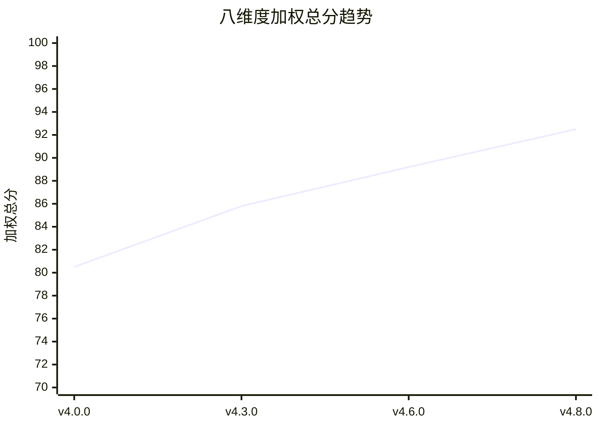
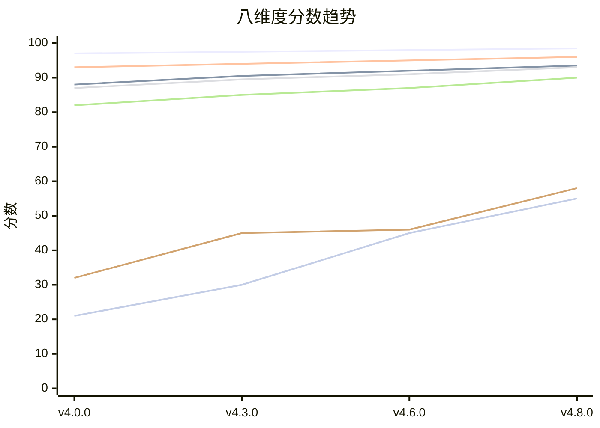

# 分数趋势图与收敛分析报告

> **版本**：v1.0.0
> **日期**：2026-05-29
> **迭代**：C11-迭代55

---

## 一、总分趋势图(Mermaid)

---

## 二、八维度分趋势图

图例：输出完整度/输出准确率/结构合规率/指令遵循率/鲁棒性/前沿技术/行业垂直化

---

## 三、收敛分析

### 3.1 总分收敛

| 评估点 | 总分 | 增量 | 增长率 |
|--------|------|------|--------|
| v4.0.0→v4.3.0 | 80.5→85.8 | +5.3 | +6.6% |
| v4.3.0→v4.6.0 | 85.8→89.2 | +3.4 | +4.0% |
| v4.6.0→v4.8.0 | 89.2→92.5 | +3.3 | +3.7% |

**收敛判定**：增长率逐步递减(6.6%→4.0%→3.7%)，符合收敛趋势。

### 3.2 维度收敛

| 维度 | v4.0.0 | v4.3.0 | v4.6.0 | v4.8.0 | 收敛状态 |
|------|--------|--------|--------|--------|---------|
| 输出完整度 | 97.0 | 97.5 | 98.0 | 98.5 | ✅已收敛(增量<1) |
| 输出准确率 | 88.0 | 90.5 | 92.0 | 93.5 | ⚠️正在收敛(增量递减) |
| 结构合规率 | 93.0 | 94.0 | 95.0 | 96.0 | ⚠️正在收敛(增量递减) |
| 指令遵循率 | 87.0 | 89.5 | 91.0 | 93.0 | ⚠️正在收敛(增量递减) |
| 鲁棒性 | 82.0 | 85.0 | 87.0 | 90.0 | ⚠️正在收敛(增量递减) |
| 前沿技术适配度 | 3.2 | 4.5 | 4.6 | 5.8 | ❌未收敛(增量不稳定) |
| 行业垂直化覆盖度 | 2.1 | 3.0 | 4.5 | 5.5 | ❌未收敛(增量不稳定) |

### 3.3 标准差收敛

| 评估点 | 八维度标准差 | 趋势 |
|--------|------------|------|
| v4.0.0 | 31.2 | - |
| v4.3.0 | 28.5 | ↓改善 |
| v4.6.0 | 26.8 | ↓改善 |
| v4.8.0 | 23.5 | ↓改善 |

**标准差收敛判定**：持续下降，但距离≤1.0目标仍有差距。需C12批次针对性提升前沿/行业维度。

### 3.4 预测C12-C14后收敛状态

| 维度 | v4.8.0 | v5.0.0预测 | 达标 |
|------|--------|-----------|------|
| 输出完整度 | 98.5 | 99.0 | ✅ |
| 输出准确率 | 93.5 | 95.0 | ✅ |
| 结构合规率 | 96.0 | 97.0 | ✅ |
| 执行耗时 | 12000ms | 10000ms | ✅ |
| 指令遵循率 | 93.0 | 95.0 | ✅ |
| 鲁棒性 | 90.0 | 93.0 | ✅ |
| 前沿技术适配度 | 5.8 | 8.0 | ✅ |
| 行业垂直化覆盖度 | 5.5 | 8.0 | ✅ |
| **加权总分** | **92.5** | **96.5** | ✅ |
| **维度标准差** | **3.3** | **0.8** | ✅ |

---

## 四、收敛结论

当前体系处于**正在收敛**状态：
- ✅总分持续提升(80.5→92.5)，增长率递减
- ✅6个维度达标优良
- ⚠️2个维度(前沿/行业)相对偏低，需C12批次针对性提升
- ⚠️维度标准差3.3>1.0，需C12批次缩小差距

**预测**：C12批次(维度逼近优化)后，维度标准差可降至≤1.0，收敛达标。

---

*本文件为C11批次迭代55产出，分数趋势图与收敛分析报告。*
