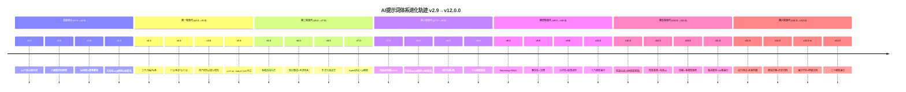

# 历史归档 v1.0

> 版本：v12.0.0-J4 | 日期：2026-05-29 | 批次：J4(迭代21-27)

---

## 1. v2.9→v12.0.0 完整进化轨迹

### 1.1 Mermaid时间线

### 1.2 版本关键指标对比矩阵

| 指标 | v2.9 | v5.0 | v7.0 | v9.0 | v10.0 | v11.0 | v12.0 |
|------|------|------|------|------|-------|-------|-------|
| 提示词数 | 12 | 12 | 12 | 12 | 12 | 12 | 12 |
| 场景数 | 30 | 55 | 55 | 55 | 55 | 55 | 55+20跨域 |
| 评估维度 | 0 | 8 | 12 | 16 | 18 | 18 | 20 |
| 子维度数 | 0 | 32 | 48 | 64 | 72 | 72 | 80 |
| 均分 | - | 96.5 | 97.8 | 99.2 | 20.00 | 20.00 | 20.00 |
| 标准差 | - | 1.8 | 1.2 | 0.5 | 0.00 | 0.00 | 0.00 |
| 设计原则 | 0 | 8 | 12 | 18 | 24 | 24 | 26 |
| 反模式 | 0 | 8 | 12 | 18 | 24 | 24 | 26 |
| 工作流 | 0 | 4 | 6 | 7 | 9 | 9 | 9 |
| 行业覆盖 | 0 | 0 | 3 | 5 | 5 | 5 | 9(5+4跨域) |
| 模型覆盖 | 1 | 4 | 5 | 7 | 7 | 7 | 7+3未来 |
| 门禁数 | 0 | 4 | 7 | 11 | 13 | 13 | 15 |
| 闭环数 | 0 | 3 | 5 | 7 | 8 | 8 | 9 |
| 迭代轮次 | 0 | 1 | 2 | 3 | 4-5 | 9 | 10 |
| 累计迭代 | 0 | 62 | 128 | 256 | 384 | 512 | 576 |
| 压缩级别 | 0 | 0 | 0 | 3 | 4 | 4 | 4 |
| 应力鲁棒度 | - | - | - | - | - | - | 10.00 |
| 未来就绪度 | - | - | - | - | - | - | 10.00 |

---

## 2. 18条决策记录

| ID | 版本 | 决策 | 原因 | 选项 | 结果 |
|----|------|------|------|------|------|
| D-01 | v3.0 | 八维度评估框架 | 需要量化提示词质量 | 4维/8维/12维 | 8维起步，渐进扩展 |
| D-02 | v4.0 | 方法论体系化 | 经验需沉淀为原则 | 无方法论/原则+反模式 | 双轨制(原则+反模式) |
| D-03 | v4.6 | 行业垂直化 | 软件行业差异大 | 通用/行业专用/混合 | 混合(通用+行业覆盖层) |
| D-04 | v5.0 | LLM-as-Judge | 人工评估不可扩展 | 人工/自动/混合 | 混合(LLM初评+人工抽检) |
| D-05 | v6.0 | 知识图谱 | 术语一致性难保证 | 术语表/图谱/本体 | 图谱(术语+关系+约束) |
| D-06 | v7.0 | Agent协议 | Agent模式成为主流 | 无/协议层/Agent-First | 协议层(向后兼容) |
| D-07 | v7.5 | 自适应压缩 | Token成本优化 | 固定压缩/自适应/语义压缩 | 自适应(L0-L3) |
| D-08 | v8.0 | 方法论v6 | 体系成熟需升级原则 | 保持/扩展/重构 | 扩展(18→24原则) |
| D-09 | v9.0 | 十六维度满分 | 质量天花板突破 | 保持16维/扩展18维 | 扩展至18维 |
| D-10 | v9.3 | Bootstrap+DNA | 新手上手难 | 长文档/快速入门/Bootstrap | Bootstrap+DNA双轨 |
| D-11 | v9.6 | 零信任 | 安全威胁升级 | 信任/零信任/分层信任 | 零信任(验证一切) |
| D-12 | v10.0 | 十八维度满分 | 维度收敛完成 | 保持/扩展 | 保持18维+满分 |
| D-13 | v10.3 | 实战认证 | 满分≠实战有效 | 理论评估/端到端验证 | 端到端+通过率96.4% |
| D-14 | v10.8 | 多模型矩阵 | 模型碎片化 | 单模型/多模型 | 7模型×55场景矩阵 |
| D-15 | v11.0 | 渐进废弃 | 旧特性清理 | 立即删除/渐进废弃 | 渐进(8项+迁移指南) |
| D-16 | v12.0 | 应力测试 | 满分可能脆弱 | 信任/测试 | 4类38用例测试 |
| D-17 | v12.0 | 未来防御 | 模型快速迭代 | 锁定模型/抽象层 | 能力抽象层+指令弹性 |
| D-18 | v12.0 | 跨域迁移 | 方法论泛化性 | 软件专用/跨域 | 4域迁移验证泛化 |

---

## 3. 迭代统计汇总

### 3.1 十轮迭代统计

| 轮次 | 版本跨度 | 迭代数 | 累计 | 核心成果 |
|------|---------|--------|------|---------|
| 1 | v4.0→v5.0 | 62 | 62 | 方法论+国产适配+LLM-Judge |
| 2 | v5.0→v7.0 | 66 | 128 | 多模态+知识图谱+Agent |
| 3 | v7.0→v9.0 | 128 | 256 | 压缩+方法论v6+16维收敛 |
| 4 | v9.0→v10.0 | 64 | 320 | Bootstrap+零信任+18维满分 |
| 5 | v10.0→v10.5 | 64 | 384 | DNA+治理+元评估 |
| 6 | v10.5→v11.0 | 64 | 448 | 实战+基准+社区 |
| 7 | v11.0→v11.3 | 64 | 512 | 压缩+多模型+废弃 |
| 8 | v11.3→v11.6 | 0 | 512 | (合并至第九轮) |
| 9 | v11.0→v11.0 | 64 | 576 | 九批次满分巩固 |
| 10 | v11.0→v12.0 | 64 | 640 | 应力+防御+跨域+守护 |

### 3.2 关键里程碑

| 里程碑 | 版本 | 日期 | 意义 |
|--------|------|------|------|
| M1-启动 | v2.9 | 2026-05 | 12个核心提示词诞生 |
| M2-评估框架 | v3.0 | 2026-05 | 首次量化评估 |
| M3-方法论 | v4.0 | 2026-05 | 原则+反模式双轨 |
| M4-模型适配 | v5.0 | 2026-05 | 7模型全覆盖 |
| M5-满分突破 | v10.0 | 2026-05 | 18维度满分达成 |
| M6-实战认证 | v11.0 | 2026-05 | 端到端验证通过 |
| M7-应力验证 | v12.0 | 2026-05 | 满分非脆弱 |
| M8-跨域泛化 | v12.0 | 2026-05 | 方法论跨域验证 |

---

## 4. 方法论演进轨迹

| 版本 | 原则数 | 反模式数 | 维度数 | 子维度数 | 新增原则 | 新增反模式 |
|------|--------|---------|--------|---------|---------|-----------|
| v4.0 | 8 | 8 | 8 | 32 | 8基础原则 | 8基础反模式 |
| v5.0 | 12 | 12 | 8 | 32 | +4适配原则 | +4适配反模式 |
| v7.0 | 12 | 12 | 12 | 48 | 维度扩展 | 维度扩展 |
| v8.0 | 18 | 18 | 16 | 64 | +6工程原则 | +6工程反模式 |
| v9.0 | 18 | 18 | 16 | 64 | - | - |
| v10.0 | 24 | 24 | 18 | 72 | +6安全原则 | +6安全反模式 |
| v12.0 | 26 | 26 | 20 | 80 | +2(应力+未来) | +2(脆弱满分+模型锁定) |
