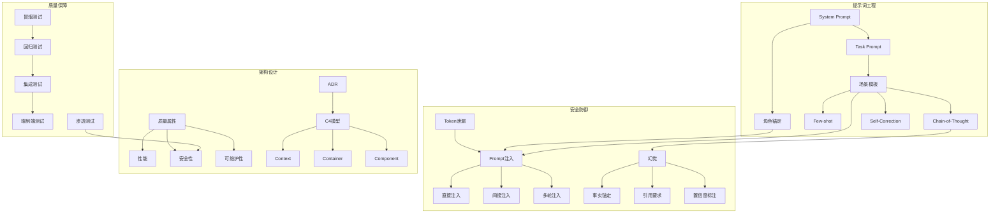
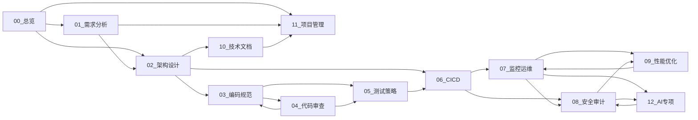

# 知识图谱驱动体系 v1.0

> **版本**：v1.0
> **日期**：2026-05-29
> **适用**：术语标准化+文档依赖+场景推荐+冲突检测

---

## 一、术语关系图谱

### 1.1 术语关系类型

| 关系类型 | 标识 | 定义 | 示例 |
|----------|------|------|------|
| 同义 | SYNONYM | 术语A与术语B语义相同 | SystemPrompt ≡ 系统提示词 |
| 依赖 | DEPENDS_ON | 术语A的定义依赖术语B | CoT DEPENDS_ON Chain-of-Thought |
| 包含 | CONTAINS | 术语A包含术语B | 安全审计 CONTAINS 渗透测试 |
| 冲突 | CONFLICTS | 术语A与术语B语义冲突 | 敏捷发布 CONFLICTS 变更冻结 |
| 偏序 | PREFERRED_OVER | 术语A优于术语B(推荐使用) | CI/CD PREFERRED_OVER 手动部署 |

### 1.2 核心术语关系图谱(Mermaid)



---

## 二、文档依赖关系图

### 2.1 文档依赖图谱(Mermaid)



### 2.2 依赖深度分析

| 文档 | 被依赖数 | 依赖数 | 变更影响范围 | 稳定性等级 |
|------|----------|--------|-------------|-----------|
| 01_需求分析 | 2 | 0 | 01→02→03→04→05→06 | 高(源头) |
| 02_架构设计 | 3 | 1 | 02→03→04→05→06→10 | 高(枢纽) |
| 04_代码审查 | 2 | 2 | 04→03→05 | 中(双向) |
| 08_安全审计 | 2 | 2 | 08→09→12 | 中(双向) |
| 12_AI专项 | 0 | 2 | 12 | 低(终端) |

---

## 三、场景推荐引擎

### 3.1 推荐逻辑

```python
def recommend_scenarios(current_scenario, task_context):
    """
    基于当前场景和任务上下文推荐下一场景

    推荐因子：
    1. 工作流顺序（当前场景在哪个工作流中，下一步是什么）
    2. 输出依赖（当前场景输出是哪些场景的输入）
    3. 任务特征（问题类型→最佳场景映射）
    4. 行业属性（当前行业→行业专用场景优先）
    5. 历史路径（用户历史执行路径的频繁后续）
    """
    workflow_next = get_workflow_next_step(current_scenario)
    output_deps = get_output_dependencies(current_scenario)
    task_match = match_task_features(task_context)
    industry_scenarios = get_industry_scenarios(task_context.industry)

    recommendations = rank_and_merge(
        workflow_next, output_deps, task_match, industry_scenarios
    )
    return recommendations
```

### 3.2 场景推荐映射表

| 当前场景 | 推荐后续(Top3) | 推荐理由 |
|----------|----------------|----------|
| 01_需求分析 | 02_架构设计, 11_项目管理, 05_测试策略 | 需求→架构(工作流), 需求→项目(计划), 需求→测试(验收) |
| 02_架构设计 | 03_编码规范, 06_CICD, 10_技术文档 | 架构→编码(实现), 架构→部署(落地), 架构→文档(记录) |
| 04_代码审查 | 03_编码规范, 05_测试策略, 08_安全审计 | 审查→编码(修复), 审查→测试(验证), 审查→安全(深化) |
| 06_CICD | 07_监控运维, 08_安全审计, 05_测试策略 | 部署→监控(工作流), 部署→安全(加固), 部署→测试(门禁) |
| 08_安全审计 | 09_性能优化, 04_代码审查, 06_CICD | 安全→性能(纵深), 安全→审查(代码), 安全→部署(加固) |

---

## 四、知识冲突检测

### 4.1 冲突类型

| 冲突类型 | 检测规则 | 示例 |
|----------|----------|------|
| 术语冲突 | 同一概念不同术语未在glossary中映射 | "蓝绿部署"vs"Blue-Green" |
| 定义冲突 | 同一术语不同文档定义不一致 | 安全审计深度在04和08不同 |
| 接口冲突 | 场景间传递字段类型不匹配 | 04输出string vs 05期望array |
| 约束冲突 | 不同文档约束条件矛盾 | 03要求强类型 vs 12建议动态类型 |

### 4.2 冲突检测流程

1. 构建术语→定义映射表
2. 检测同义词未映射项
3. 检测定义不一致项
4. 检测接口类型不匹配项
5. 检测约束矛盾项
6. 输出冲突报告+修复建议
